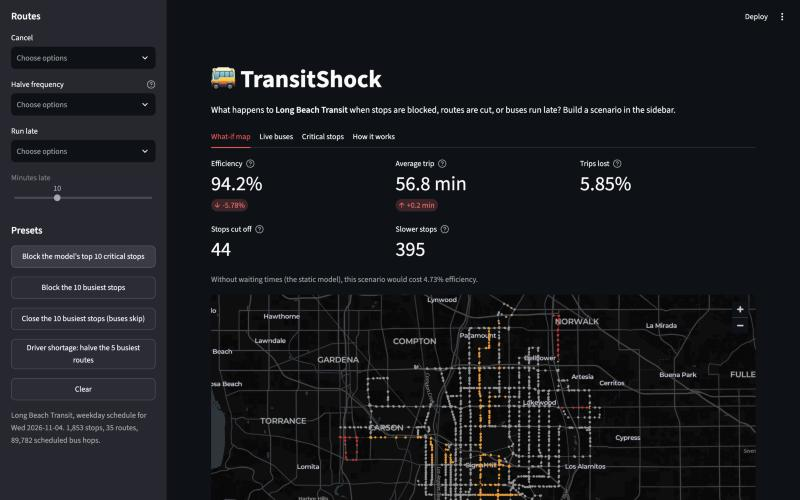
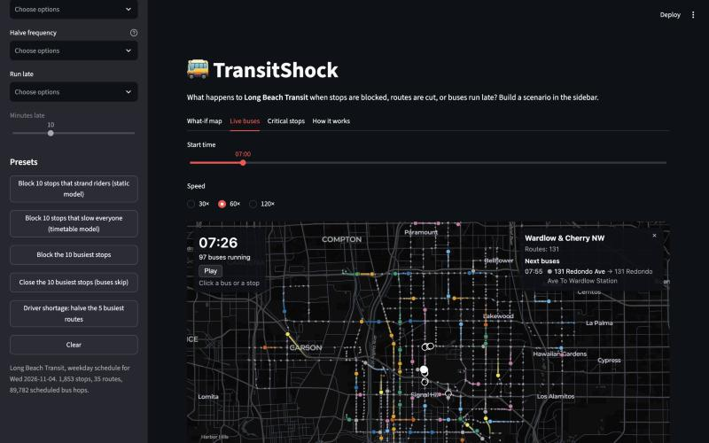

# TransitShock

**What happens to a city's bus network when stops or routes go down, and can a model predict which stops matter most without simulating every failure?**

TransitShock turns Long Beach Transit's public schedule (GTFS) into a graph of 1,853 stops and a timetable of 89,782 scheduled bus hops. It simulates disruptions and trains a model that ranks how damaging each stop's closure would be.

A Streamlit app lets you block stops, cancel or thin out routes, or make buses run late. It shows who gets cut off, using real door-to-door times that include waiting. It also animates the disrupted buses along the actual streets, showing canceled buses as ghosts and coloring stops by impact. Click any bus for its route's impact and next stops, or any stop for its impact and the next buses due. An optional **greedy search** finds the worst combination of stops to block, and a toggle expands the network to **all of LA Metro's buses and rail** (about 14,000 stops).

**Live demo:** https://transitshock-7skwnhd9xngwvzgy53urnz.streamlit.app/





## Key results

| Finding | Number |
|---|---|
| Blocking the **10 busiest** stops (static model) | −1.4% network efficiency, 0 stops cut off |
| Blocking the model's **10 most critical** stops (static model) | −4.7% network efficiency, **44 stops cut off** |
| The same blockage, with real timetable waiting times | **−5.8%**, the same 44 cut off; **99 cut off** in the evening |
| Waiting for buses and transfers | Average door-to-door trip **56.6 min vs. 28.6 min** without waiting (1.98×) |
| Model vs. betweenness alone at ranking stops (held-out neighborhoods) | Spearman ρ **0.88** vs. 0.80 |
| True top-5% critical stops the model finds | **65%** (betweenness alone: 47%) |
| Compute vs. exhaustive simulation | **≈58× less** (≈10 s vs. 573 CPU-s) |
| Timetable routing speed (Connection Scan Algorithm + numba) | 0.05 ms per query; a 15,000-query scenario in ≈0.2 s |
| Model retrained on timetable damage (held-out neighborhoods) | ρ **0.73**, finds **60%** of critical stops; the static-trained model manages 0.59 and 39% on the same labels |
| LA-wide network (LBT + Metro bus + Metro rail) | 13,847 stops, 155 routes, 957K scheduled hops; average door-to-door trip ≈ **95 min** (morning peak, sampled) |
| Canceling the Metro A Line (morning peak, all of LA) | **−4.9%** efficiency, +3.1 min average trip, ≈800 stops cut off |
| Canceling all 6 Metro rail lines | **−18%** efficiency, +7.5 min average trip |
| Greedy search for the worst 10 stops to block (lazy/CELF) | **−8.5%** efficiency, 46 cut off, 1,272 slower; beats the true single-stop top 10 (−7.6%) with 96 scenario evaluations |
| Random failures vs. targeting busy stops | Random failures halve efficiency after removing 10% of stops; targeting busy stops takes 20% |

**Takeaways:**
- **Busy stops aren't the critical ones.** Trips per day has essentially zero correlation with how much a closure hurts the network.
- **Bus routes are chains.** 85% of consecutive stops are farther apart than a 200 m walk, so losing one stop often cuts its route. That's why random failures do more damage than targeting busy stops.
- **The model's biggest gain came from looking at its mistakes.** It was missing stops that strand other stops. A feature built on **dominator trees** (a compiler algorithm) measures stranding exactly, and adding it raised the critical stops found from 51% to 65%.
- **Waiting changes the picture.** Real timetable routing nearly doubles travel times. It shows the same blockage hurts more at night, when buses run less often, and it separates a *blocked* stop (nothing passes) from a *closed* one (buses skip it), which is a much milder disruption.
- **"Critical" depends on what you measure.** The static model finds stops whose blockage **strands** riders (44 stops cut off). The timetable-trained model finds **frequent corridors** whose blockage slows everyone: 899 stops slower and +3 minutes on the average trip. Once waiting counts, trips/day becomes as important a feature as betweenness.

## How it works

```
GTFS feeds ──► load_gtfs ──► build_graph ──► metrics / simulate ──► features ──► model ──► app
(schedule)     one weekday    stops + edges    what breaks?          per-stop     predict    what-if
                    │         (travel time,                          clues        damage     demo
                    │          walking ≤200 m)                                                 ▲
                    └──────► timetable ──► csa (door-to-door with waiting) ──► scenario ──────┘
```

| Step | What it does |
|---|---|
| **Graph** | Stops are nodes. Consecutive stops on a trip are linked by directed edges weighted by median scheduled travel time. Stops within 200 m are linked by walking edges. Rail platforms are merged into their stations. |
| **Health metric** | Network *efficiency*: the average of 1 / travel time over all stop pairs. All-pairs shortest paths use scipy's C-based Dijkstra, about 0.3 s per network. |
| **Simulation** | Random vs. targeted attacks (degree, trips/day, betweenness; static and adaptive), single-route outages, and removing each of the 1,853 stops one at a time, run in parallel across CPU cores. |
| **Model** | A random forest predicts the log of single-stop damage from 14 graph features. It's evaluated with **spatial cross-validation**, holding out whole neighborhoods, so neighboring stops can't leak between training and testing. |
| **Timetable routing** | The **Connection Scan Algorithm** scans every scheduled bus hop in departure order to find earliest arrivals, including waits and transfers. It's compiled with numba and runs in parallel. Disruptions (blocked or closed stops, canceled or halved routes, delays) edit the timetable, which is then re-scanned. |
| **Live map** | A deck.gl `TripsLayer` animates one hour of the (disrupted) schedule in the browser. Buses follow the GTFS street shapes (simplified with Douglas-Peucker), timed by distance traveled. Canceled buses appear as ghosts, and stops are colored by impact. Clicking a bus shows its route's impact numbers; clicking a stop shows its own. |
| **All of LA (toggle)** | LBT, Metro bus and Metro rail are combined into one timetable, with route IDs prefixed by agency. Metro's feeds don't give stop distances along shapes, so stops are projected onto the shapes in order. Routing samples 300 origin stops every 30 minutes, and the live map shows 30 minutes at a time with paths clipped to the visible window, keeping the browser payload around 2.5 MB. |
| **Worst-case search** | Greedy selection with lazy (CELF) evaluation: pick the stop that adds the most damage given those already blocked, re-measuring only the current leader. |

## Repo layout

```
src/transitshock/   load_gtfs, build_graph, metrics, simulate, features, model,
                    timetable, csa, scenario, animation, app_data
app/                streamlit_app.py, live_buses.html, data/ (small export the demo runs on)
notebooks/          01 explore GTFS · 02 graph stats · 03 robustness · 04 model · 05 timetable
                    · 06 timetable-trained model
notes/              gtfs_notes.md (data quirks) · code_walkthrough.md (module-by-module guide)
scripts/            download_data.sh · run_pipeline.py
tests/              89 pytest tests on small hand-built networks and timetables + app smoke tests
```

## Run it

```bash
python3 -m venv .venv && source .venv/bin/activate
pip install -r requirements.txt && pip install -e .

streamlit run app/streamlit_app.py      # demo (uses the committed app/data/)
pytest                                  # tests
```

To rebuild everything from the raw schedules (about 6 minutes on 10 cores):

```bash
./scripts/download_data.sh
python scripts/run_pipeline.py --feed lbt --date 20261104 --with-la   # --with-la: also the LA-wide network
```

## Limitations

- **The greedy search is a heuristic.** Lazy evaluation (CELF) is exact only when damage has diminishing returns, and blockages here sometimes compound. It also only searches the models' top candidates.
- **Riders are spread evenly** across stops and departure times, because stop-level ridership data isn't public.
- **The schedule is assumed to run perfectly** apart from the scenario. The agency interpolates about 86% of bus times, and there's no real-time data.
- **The LA-wide numbers are estimates.** They route from 300 sampled origin stops, and each stop is judged by trips *to* it. The critical-stop models and greedy search are LBT-only, because exhaustive labels for 14,000 stops would take hours.
- **Memory.** With both networks loaded, the app uses about 1.3 GB. That fits Streamlit Community Cloud but doesn't leave much headroom.
- **Fares aren't modeled.** Travel time is the only cost.
- **One agency (LBT).** The next test is whether the model transfers to LA Metro, which is 6× larger.

## Built with

Python · pandas · NetworkX · SciPy (sparse graphs, Dijkstra) · numba · scikit-learn · Streamlit · pydeck / deck.gl · pytest · GitHub Actions
